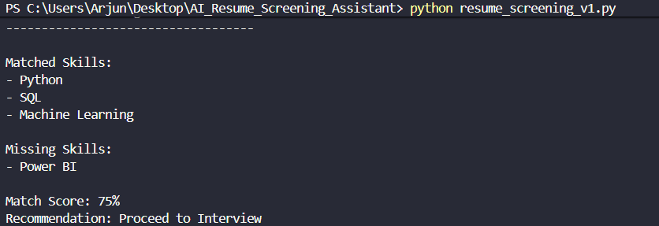
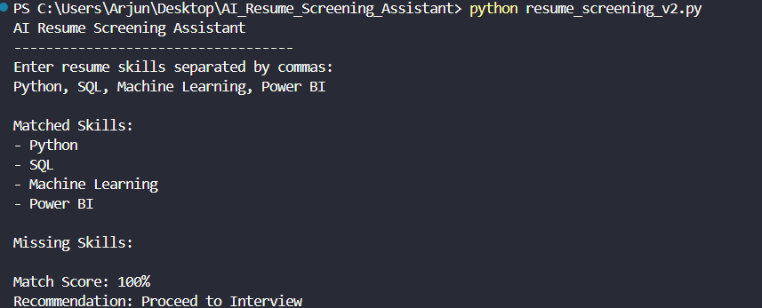
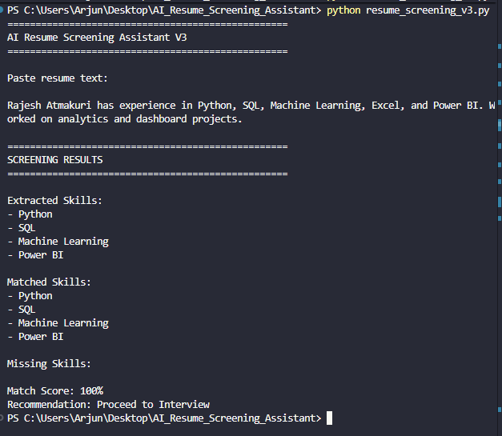

# AI Resume Screening Assistant

Screens resumes against job descriptions and recommends whether a candidate should proceed to interview. Paste a job description and a resume, and it extracts the required skills, finds the matches and gaps, and produces a match score with an interview recommendation.

Built as a workflow-automation project (BCIS 5140 – Artificial Intelligence in Business) and developed iteratively across four versions, from fixed skill matching to full job-description analysis.

---

## How to Run

Requires Python 3.8+ — no external packages to install (standard library only).

```bash
git clone https://github.com/rajeshatmakuri17/AI_Resume_Screening_Assistant.git
cd AI_Resume_Screening_Assistant
python resume_screening_v4.py
```

When prompted, paste the job description, then paste the resume text. The latest version (`resume_screening_v4.py`) is the one to run.

---

## Try It with the Samples

The `samples/` folder has a sample job description and a sample resume (fictional candidate). Run v4 and paste them in to see:

```text
Match Score: 80%
Recommendation: Proceed to Interview
```

The full output is saved in `samples/example_output.txt` — the sample candidate matches 4 of 5 required skills (Python, SQL, Power BI, Excel) and is missing Machine Learning.

---

## Features

### Version 1
- Fixed skill matching
- Match score calculation
- Recommendation generation

### Version 2
- Dynamic user input
- Multiple candidate evaluation

### Version 3
- Resume text analysis
- Automatic skill extraction

### Version 4
- Job description analysis
- Resume comparison
- Missing skill identification
- Match score generation
- Interview recommendation

---

## Technologies Used

- Python (standard library only)
- Git
- GitHub
- Visual Studio Code

---

## Project Structure

```text
AI_Resume_Screening_Assistant
│
├── docs
├── samples
│   ├── sample_job_description.txt
│   ├── sample_resume.txt
│   └── example_output.txt
├── screenshots
├── test_cases
├── requirements.txt
├── resume_screening_v1.py
├── resume_screening_v2.py
├── resume_screening_v3.py
├── resume_screening_v4.py
└── README.md
```

---

## Testing

Five test cases were executed. Pass mark: 75% match score.

| Test Case | Match Score | Result |
|-----------|------------|---------|
| 1 | 75% | Pass |
| 2 | 100% | Pass |
| 3 | 50% | Fail |
| 4 | 25% | Fail |
| 5 | 0% | Fail |

## Screenshots

### Version 1 — first working output


### Version 2 — Test Case 2


### Version 3 — improved system


---

## Future Improvements

- LLM-powered skill extraction (planned after the LangChain course)
- Deploy with FastAPI + Docker
- Add MLflow experiment tracking
